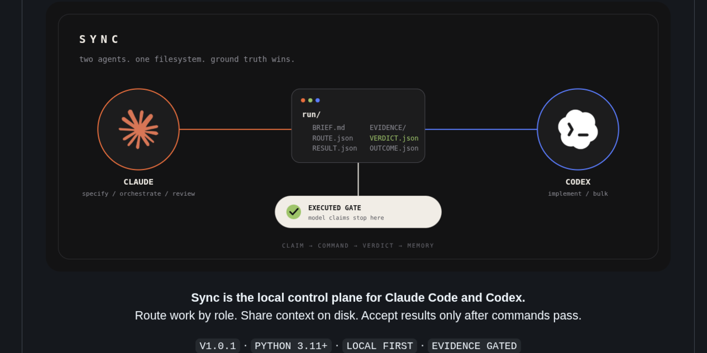
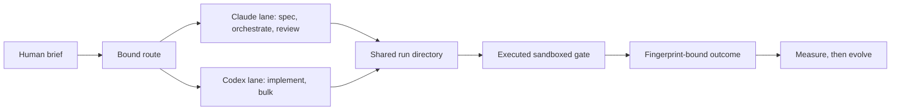

# Sync



Choose a role once. Sync binds the task to a harness, model, effort, and
**billing pool**, moves the work through a shared run directory, and records the
executed verdict. Routing policy can then evolve from evidence instead of
impression.

**Maturity: market-ready locally, with hosted CI required on the exact tagged
release.** The market-ready audit is bound to an exact source-tree fingerprint,
so any source change invalidates its evidence until the acceptance suite runs
again. The controls in `bin/` have hermetic regression
coverage, including a local fake executor, typed artifact binding, redaction,
and hostile gate-containment tests. The fixed-input demo proves identical tree
shape and file bytes across two clean builds. A real Sync-run adapter validates
artifact bindings before importing a sanitized record and cited vault report.
This hardening pass did not invoke Claude or Codex through Sync's local dispatch
path or create a live council run.

What has not happened is measurement. No validated schema-v2 baseline is bundled,
so Sync's value is a hypothesis with a working mechanism, not a demonstrated
result. Legacy ledger rows are counted as invalid rather than silently promoted.
See doctrine 006, which is about exactly this trap.

## The philosophy

1. Models propose. Commands decide.
2. Context on disk beats repeated explanation.
3. Spend frontier intelligence on ambiguity, not typing.
4. No source, no claim. No verification path, no release.
5. Routing changes after recorded outcomes, never after a good feeling.



## Buyer

An operator running both Claude Code and Codex who is blocked by allowance rather
than by capability, and who wants routing, verification, and capacity decisions
enforced by the harness instead of described in an instruction file that the
system prompt outranks.

## Outputs

- A routing decision per task: role, harness, model, effort, and billing pool
- A run directory holding the brief, the plan, captured redacted evidence, and a verdict
- A verdict that is a set of executed commands with exit codes, not a summary
- An artifact-derived outcome ledger, and policy proposals derived only from it;
  live Claude pressure remains statusline-only
- An enforcement audit: what the doctrine prescribes against what actually fires

## Quick start

```bash
bin/sync doctor            # local auth, CLI flags, sandbox, and headroom checks
bin/sync-install           # dry run, shows the diff and what it leaves alone
bin/sync-install --apply   # writes, after backing up settings.json
bin/sync policy            # the role table and the autonomy envelope
sync-brain import-run --vault <vault> --run-dir <run-directory>
```

## The one idea

Two distinct local pool declarations can be eligible for capacity relief when
their non-secret authentication modes are observed and both have current
headroom. Two product names, subscriptions, or models do not prove that on their
own.

Claude documents that claude.ai, Claude Code, and Claude Desktop share a usage
limit. OpenAI documents that Codex shares an agentic usage and credit pool with
ChatGPT Work, ChatGPT for Excel, and Workspace Agents where available. Sync calls
a route eligible for capacity relief only after
`references/pool-inventory.json` records distinct local pool declarations,
observed non-secret authentication modes, and currently available headroom for
both source and destination. Exact account and workspace identifiers are
intentionally not stored. Otherwise it is a preference, not a capacity claim.

Every routing claim names the source and destination pool identity. A claim that
cannot name a distinct destination pool is a cost optimisation wearing a capacity
costume.

Quality routing is a separate decision. The current table keeps `spec`,
`orchestrate`, and `stuck` on Claude Code's documented `best` alias, uses GPT-5.6
Terra at medium effort for well-specified implementation, and uses GPT-5.6 Luna
at low effort for mechanical bulk work. Review remains fresh-context and
non-author. These are current vendor-guided defaults recorded in the source and
claim ledgers, not measured winners for this repository.

## What is actually here

| Component | State | What it does |
|---|---|---|
| `bin/sync policy` | working | prints the role table, pools, and autonomy envelope |
| `bin/sync route` | working | resolves a role to a lane; fired triggers move `implement` or `bulk` to `stuck` and are recorded for every role |
| `bin/sync run` | working | opens and lists artifact-mediated run directories |
| `bin/sync gate` | working | executes argv-only checks in a network-isolated Bubblewrap sandbox, writes a verdict, saves redacted evidence |
| `bin/sync gate --hook` | working | blocks a non-pass with exit 2 and returns a bounded redacted diagnostic tail; malformed payloads and active hook loops fail open |
| `bin/sync codex` | working | dispatches a bounded brief through strict, ephemeral `codex exec` and requires typed output |
| `bin/sync record` | working | derives a fingerprint-bound outcome from route, dispatch, result, and verdict artifacts |
| `bin/sync measure` | working | valid run counts, wall-clock time, executor outcomes, and gate outcomes by declared pool label |
| `bin/sync evolve` | working | proposes policy changes, refuses under 10 runs |
| `bin/sync doctor` | working | checks non-secret auth modes, required Codex flags, sandbox usability, and declared headroom |
| `bin/sync-statusline` | working | shows live Claude pressure and prompts a route eligibility check |
| `bin/sync-install` | working | previews a transaction, records Claude settings and Codex skill-link state, and reverts both unless the user changed them afterward |
| `sync-brain import-run` | working | verifies a recorded Sync run, excludes arbitrary model output, preserves a normalized `.raw` record, and renders a cited report |
| `skills/sync/` | written | the operating skill Claude loads |
| `references/doctrine/` | 7 notes | authored doctrine, each stating what its evidence does not prove |
| `references/canon/` | 23 source notes plus index | generated output folded from the source ledger. **Never author here**, `synthesize_brain.py` deletes and rewrites it |
| outcome ledger | no bundled schema-v2 baseline | `evolve` requires at least 10 valid runs and ignores malformed or legacy rows |

## Install

`sync-install` is dry-run by default. It appends to `hooks.Stop`, preserves
existing hooks and permissions, snapshots `settings.json` and the Codex skill
link, and records a private transaction before applying. Revert restores both
states and refuses to overwrite changes made after installation. The portable
shell installer stages replacements, refuses user-owned targets, rolls back a
partial transaction, and restores the exact previous Gemini loader.

## Boundaries

Brain maintenance and secretary answers are advisory and read-only. A run-bound
executor may make reversible edits inside its canonical project under the brief.
Gate commands run with network isolation, a private home, and a narrow read-only
system and toolchain allowlist. Only the bound project and a private temporary
directory map back as writable host paths, and `.git` is remounted read-only.
Running gates without that sandbox requires the explicit
`--allow-unsandboxed-gates` operator override.

Requires a human: commit, push, publish, deploy, third-party contact, spending,
account or permission changes, anything outside the workspace, anything
irreversible without a rollback path.

The full envelope is machine-readable in `references/routing-policy.json`, and
`sync codex` injects these constraints into the executor's prompt rather than
trusting it to remember them.

## The loop

```bash
sync run new fix-auth-timeout                    # open a run directory
# fill BRIEF.md: done criteria must be commands, not adjectives
sync route --role implement --source-pool claude --run <id>  # bind a lane
sync codex implement --run <id>                  # requires the bound Git worktree
sync gate --run <id>                             # ground truth, redacted evidence
sync record --run <id>                           # derives facts from run artifacts
```

`sync codex` records dispatch provenance, a redacted captured event stream, and
its structured result in the run. It requires a Git worktree by default;
`--allow-non-git` is an explicit recorded exception. A reported success is still
a claim. `sync gate` is the verdict.

A project-owned `.sync/gates.json` is discovered but not trusted on its own. To
execute it, bind the project to a run, pass `--allow-project-gates`, and pass the
exact file hash with `--project-gate-sha256`. Changing one byte invalidates that
acknowledgment. The hash prevents stale or changed configuration from running; it
does not cryptographically authenticate a human. Owner authorization remains a
caller-policy boundary, and an executor must not supply these flags unless the
owner has approved them.

## Three gate results, and the third is the one people get wrong

`pass` is supported by executed evidence. `fail` is contradicted by executed
evidence. `inconclusive` means the runner was absent, found nothing to run, or
the available evidence cannot settle the result.

An inconclusive result is not a pass. `pytest` exiting 5 means no tests were collected. A project
with no tests has not been tested however green the summary looks, so Sync
records the skip reason and reports it.

## Provenance

Doctrine adapts the source-cited canon in Agent Ops Brain, narrowed to the
two-pool case and rewritten so every note names the control that enforces it.
Token and quota research comes from TokenDinosaur. Harness mechanics (hook exit
codes, statusline contract, tool search) come from the Fable 5 Brain. Vault
structure, audit gate, and packaging come from Brainstein.

Sync is an independent project. Claude is a trademark of Anthropic. Codex and
OpenAI are trademarks of OpenAI. Their names identify compatible execution
lanes and do not imply partnership, sponsorship, or endorsement. The visual
above uses the supplied vendor marks only to identify those compatible lanes.

## Honest gaps

- **There is no validated schema-v2 baseline.** No claim that Sync helps is
  supported yet. Record a baseline before adopting it broadly.
- **Pool boundaries must be declared and checked.** The inventory records the
  operator's local pool labels and observed non-secret authentication modes, not
  exact account or workspace identifiers. Both source and destination headroom
  are currently `not recorded`, so cross-pool relief is unverified.
- **Escalation thresholds are borrowed**, from studies on other codebases and
  model generations. They should be re-derived from this operator's own ledger.
- **`sync measure` cannot read live Claude quota.** That is only exposed to the
  statusline inside a session.
- **Hosted CI and local evidence are separate gates.** A release must target the
  exact revision that passed both checks.
- **The public release surface permits fixture-only `.raw` material.** Client
  raw material remains forbidden. The release scanner enforces the two reviewed
  fixture roots and rejects any other raw path.
- **Gate containment currently depends on Bubblewrap on Linux.** Without it, the
  gate is inconclusive unless a human explicitly permits unsandboxed execution.
- **Cross-vendor relief is conditional.** It applies only when the inventory has
  distinct Anthropic and OpenAI account pools. It is not a property of the word
  "Codex" or an unverified promise about a particular plan.
